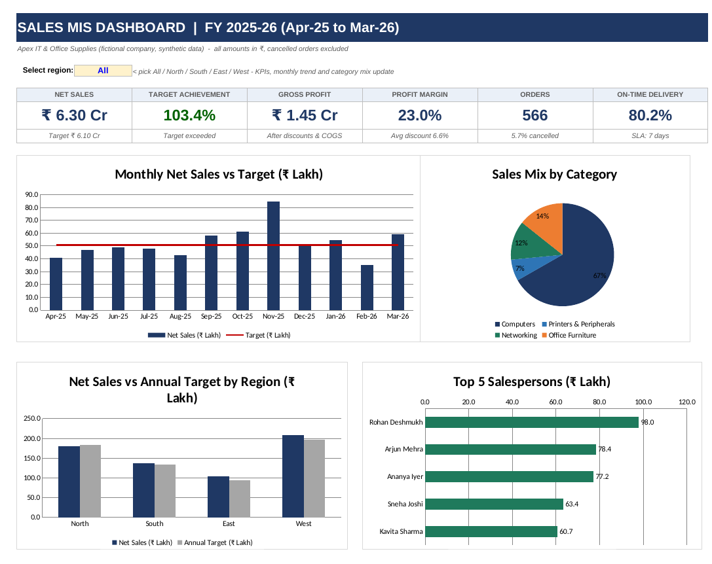

# Sales MIS Dashboard (Excel)

A formula-driven **Management Information System (MIS) report** in Excel for a fictional B2B IT & office-supplies distributor, FY 2025-26 (Apr-25 to Mar-26). It turns 600 raw order lines into a monthly MIS pack, a salesperson scorecard and an interactive dashboard, with built-in data-quality checks.

> All data is **synthetic** (seeded random generator) - no real company or customer information.



## What it does

| Sheet | Purpose |
|---|---|
| **Dashboard** | 6 KPI cards + 4 charts, with a region selector (All / North / South / East / West) that drives the KPIs, monthly trend and category mix |
| **MIS_Report** | Monthly summary vs target (orders, units, gross/net sales, discount, COGS, profit, margin, achievement %, MoM growth, cancellations); region x month matrix; category summary |
| **Salesperson_Scorecard** | Rank, target achievement, margin, cancellation %, on-time delivery % and a performance rating per salesperson |
| **Sales_Data** | 600 order lines. Raw inputs + formula columns (lookups, gross/net sales, COGS, profit, delivery days, SLA flag) |
| **Masters** | Product, salesperson/target and SLA assumptions |
| **Data_Quality** | 12 automated validation & reconciliation checks (missing values, duplicates, unmapped codes, date logic, totals tie-out) |
| **Calc** | Helper tables feeding the charts |

## Skills demonstrated

- **Lookups & aggregation:** `INDEX/MATCH`, `SUMIFS`, `COUNTIFS`, `SUMIF`, `LARGE`, `RANK`, `SUMPRODUCT`
- **Wildcard-driven filtering** (`"*"` criterion) so one dropdown filters the whole dashboard without macros
- **MIS reporting:** target vs actual, MoM growth, margin analysis, region/category cuts, SLA tracking
- **Dashboard design:** KPI cards, combo bar+line chart, pie, clustered and horizontal bar charts
- **Data validation & conditional formatting:** dropdowns, traffic-light achievement, colour scales
- **Data quality & reconciliation:** every report total ties back to raw data (all checks = PASS)
- **Modelling hygiene:** zero hard-coded results, colour-coded inputs/formulas, documented assumptions
- Indian number formatting (lakh/crore grouping, ₹)

## Key findings (from the data)

- FY net sales **₹6.30 Cr** vs target **₹6.10 Cr** (**103.4%** achievement), gross margin **23.0%**
- **Nov-25** was the peak month (₹84.5 L, 166% of target - festive season); **Feb-26** was the weakest (69% of target)
- **Computers** drive 67% of sales but carry the lowest margin (21.3%); **Printers & Peripherals** has the best margin (27.7%) at only 7% of sales
- **West** is the largest region (₹2.09 Cr); 7 of 10 salespeople exceeded their annual target
- Overall on-time delivery is **80.2%** against a 7-day SLA; 5.7% of orders were cancelled

## How to use

1. Open `Sales_MIS_Dashboard.xlsx` (Excel 2010+; no macros).
2. Go to **Dashboard** and change the region in the yellow cell **C4**.
3. To refresh with new data: append rows to **Sales_Data**, copy the green formula columns down, then confirm **Data_Quality** shows *ALL CHECKS PASSED*.

## Rebuild from scratch

```bash
pip install openpyxl
python build_mis_workbook.py      # writes Sales_MIS_Dashboard.xlsx and sales_data.csv
```

The generator is seeded (`SEED = 42`), so the same data and workbook are produced every time. `sales_data.csv` contains the raw input columns only.

## Repository structure

```
.
├── Sales_MIS_Dashboard.xlsx   # the workbook
├── build_mis_workbook.py      # script that generates it
├── sales_data.csv             # raw synthetic input data
├── docs/dashboard.png         # screenshot used above
└── README.md
```
